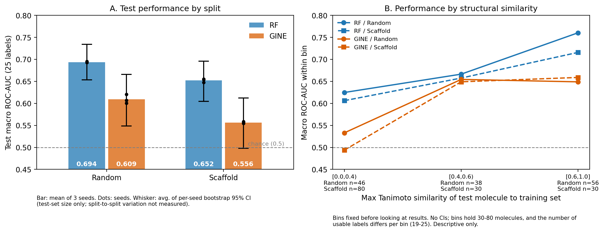

# How much does a scaffold split lower side-effect prediction performance on SIDER?

A small, reproducible study comparing **random** and **Bemis-Murcko scaffold** splits on the MoleculeNet SIDER
dataset, using a Morgan-fingerprint Random Forest (RF) and a GINE graph neural network, and asking whether the
performance drop is related to how structurally similar test molecules are to the training set.

This is an evaluation study, not an attempt to build a good side-effect predictor. All results below are
observations under a fixed, untuned protocol on a small dataset; see [Limitations](#limitations).

## Research question

> In SIDER side-effect-class prediction, how much does a scaffold split lower performance relative to a random
> split (GINE vs. Morgan-RF), and is that drop explained by the structural similarity (maximum Tanimoto) between
> test molecules and the training set?

## Summary of findings

All numbers are test macro ROC-AUC over 25 labels (see tables for details).

- Both models scored lower on the scaffold split than on the random split (RF 0.694 -> 0.652, GINE 0.609 -> 0.556).
  The direction is consistent, but within each model the bootstrap 95% CIs of the two splits overlap, so the size of
  the drop is uncertain with a 140-molecule test set.
- The scaffold test set is structurally less similar to its training set than the random test set
  (median max-Tanimoto 0.336 vs 0.522).
- Within the test sets, molecules that are more similar to the training set tend to have lower prediction error
  (Spearman rho -0.15 to -0.28, descriptive only), and RF macro-AUC rises across fixed similarity bins.
  This is consistent with the drop being related to structural similarity, but it is not a causal or quantitative
  decomposition.
- With fixed, untuned hyper-parameters, GINE scored below RF on both splits, and was near chance (about 0.5) on
  test molecules with max-Tanimoto < 0.4 in the scaffold split. This does not show that GINE is inherently worse.

## Data

- **Dataset:** MoleculeNet SIDER (`sider.csv.gz` from the DeepChem S3 bucket): SMILES and 27 binary labels at the
  MedDRA system-organ-class (SOC) level.
- **Cleaning:** keep the largest fragment (removes salts/counter-ions); duplicates after standardization are merged
  by logical OR of labels (a side effect reported for any form of the parent compound is treated as positive).
- **After cleaning:** 1,427 raw rows -> 1,394 molecules. 0 invalid SMILES, 182 multi-fragment molecules,
  33 duplicate rows merged (25 groups had conflicting labels). No missing labels. Mean 15.38 positive labels per molecule.
- **Labels used:** 25 of 27. A label is used only if it has at least 3 positives and 3 negatives in both the
  validation and test sets of both splits (excluded: *Product issues*, *Nervous system disorders*).
- **Positive rate** per label ranges from about 9% (Pregnancy, puerperium and perinatal conditions) to about 93% (Skin).

### Splits (80/10/10; train 1,115 / valid 139 / test 140)

| Split | Description | Test scaffold also in train | Test median max-Tanimoto to train | Test fraction with max-Tanimoto > 0.7 |
|---|---|---|---|---|
| Random | one permutation, seed 0 | 49.3% | 0.522 | 22.9% |
| Scaffold | deterministic Bemis-Murcko, largest scaffold groups go to train | 0% | 0.336 | 12.1% |

Tanimoto similarity uses Morgan fingerprints (radius 2, 2048 bits). The scaffold test set consists mostly of
single-molecule scaffolds (rare ring systems); acyclic molecules (10.6% of the data) all fall in the training set.

## Methods

**Metrics.** Primary: macro ROC-AUC over the 25 labels. Secondary: macro ROC-AUC over 19 "organ-system" labels
(excluding 6 SOC classes that are clinical/administrative categories rather than organ-system responses:
Social circumstances; Surgical and medical procedures; Investigations; Injury, poisoning and procedural
complications; Pregnancy, puerperium and perinatal conditions; Congenital, familial and genetic disorders).
This subset was defined before any model was run. Per-label AUCs are saved but not interpreted individually.
PR-AUC is not used as a primary metric because label prevalence varies widely.

**Uncertainty.** 95% percentile bootstrap CI (500 resamples) over test molecules. It reflects test-set size only;
it does not reflect the choice of split.

**Models (fixed in advance, no hyper-parameter tuning).**

- *Morgan-RF:* Morgan fingerprint (radius 2, 2048 bits) + scikit-learn `RandomForestClassifier` (500 trees,
  native multi-output), seeds 0/1/2.
- *GINE:* 3 GINE layers (hidden 128, BatchNorm, ReLU, dropout 0.2), mean pooling, MLP head, masked multi-label
  BCE-with-logits; atom features 34-d, bond features 10-d; Adam (lr 1e-3, weight decay 1e-5), batch size 32,
  up to 100 epochs, model selection by validation macro-AUC with patience 20; model seeds 0/1/2.
  The test set is never used for any decision.

**Similarity analysis.** For each test molecule, the maximum Tanimoto similarity to any training molecule.
(1) Spearman correlation between this similarity and the per-molecule Brier error (averaged over seeds),
descriptive only, no p-value. (2) Macro ROC-AUC within three fixed similarity bins (<0.4, 0.4-0.6, >=0.6),
defined before looking at results; a label counts in a bin only if the bin has at least 3 positives and 3 negatives,
and a bin is reported only if at least 10 labels are usable.

## Results

### Test macro ROC-AUC (mean +/- sample SD over 3 model seeds)

| Model | Split | All 25 labels | 19 organ-system labels | Per-seed 95% CI range (all 25) |
|---|---|---|---|---|
| Morgan-RF | Random | 0.694 +/- 0.001 | 0.702 +/- 0.002 | 0.653 - 0.737 |
| Morgan-RF | Scaffold | 0.652 +/- 0.004 | 0.661 +/- 0.003 | 0.599 - 0.699 |
| GINE | Random | 0.609 +/- 0.010 | 0.608 +/- 0.013 | 0.541 - 0.678 |
| GINE | Scaffold | 0.556 +/- 0.002 | 0.562 +/- 0.003 | 0.496 - 0.615 |

Random minus scaffold: RF 0.042, GINE 0.053. The SD over seeds reflects model initialization (and forest randomness)
only; all seeds use the same split and the same 140 test molecules. The exact values are in `results/*.json`
(the 19-label columns and the CI ranges are derived from the per-seed values printed during the runs; re-derive from
the JSON files if in doubt).

### Performance by structural similarity (mean of 3 seeds, 25-label macro-AUC within each bin)

| Split | Model | max-Tanimoto [0, 0.4) | [0.4, 0.6) | [0.6, 1.0] |
|---|---|---|---|---|
| Random | RF | 0.625 (n=46) | 0.666 (n=38) | 0.760 (n=56) |
| Random | GINE | 0.533 (n=46) | 0.654 (n=38) | 0.649 (n=56) |
| Scaffold | RF | 0.606 (n=80) | 0.657 (n=30) | 0.716 (n=30) |
| Scaffold | GINE | 0.494 (n=80) | 0.649 (n=30) | 0.659 (n=30) |

Usable labels per bin range from 19 to 25. Bins have no CIs and contain 30-80 molecules, so differences between
cells may be due to chance. In the scaffold test set 57% of molecules (80/140) are in the least-similar bin versus
33% (46/140) in the random test set; a plausible but untested explanation is that this composition difference
contributes to the lower scaffold average.

Spearman correlation between max-Tanimoto and Brier error (descriptive only):
Random: RF -0.280, GINE -0.237. Scaffold: RF -0.172, GINE -0.151.



## Limitations

- Random and scaffold splits measure different generalization settings. A scaffold split does not guarantee
  structural dissimilarity: 12.1% of scaffold test molecules still have a training neighbour with Tanimoto > 0.7.
- The scaffold test set is dominated by single-molecule scaffolds (rare ring systems), and acyclic molecules are
  all in the training set.
- The test set has only 140 molecules, so CIs are wide. The random split was generated once, and the scaffold split
  is deterministic, so variation due to the choice of split is not measured. Three seeds capture model
  initialization variation only.
- No hyper-parameter tuning was done, on purpose: the validation set is small (139 molecules) and the goal was a
  like-for-like comparison across splits. The lower GINE scores may partly reflect this and should not be read as
  GINE being inherently worse than RF. Several GINE runs reached or approached the 100-epoch cap with a noisy
  validation curve; convergence was not analyzed.
- The validation scores of GINE are optimistically biased because they were used to pick the best epoch, so they
  should not be compared directly with test scores. Validation and test sets are small, and the valid/test
  differences seen for either model were not interpreted.
- SIDER associations are not causal evidence. A label that is not reported is not the same as "no side effect".
  Dose, exposure, patient characteristics and metabolism are not in the SMILES. Structural distance is not
  biological activity distance.
- Labels are coarse SOC-level classes, and some SOCs are clinical record categories rather than biological responses.
- Models predict whether a side-effect class is likely to be *recorded in SIDER* for a molecule that is already in
  SIDER. This study does not show how models behave on molecules with no records.
- Similarity-bin analysis is descriptive: the bins contain different molecules in each split, labels usable per bin
  differ, and no statistical test was run.
- The model results should not be interpreted as evidence that these models can predict side effects, and no
  biological mechanism is claimed.

## Reproducing the results

All scripts live in one flat folder and import each other, so run the commands from that folder.
Developed and run on Google Colab (CPU).

```bash
pip install rdkit torch-geometric pandas scikit-learn scipy matplotlib
python prepare_data.py --dataset sider            # download, clean, audit, splits -> data/processed/
python featurize.py --dataset sider --split scaffold   # optional: featurization integrity check
python smoke_test_gine.py --dataset sider --split scaffold   # optional: one-off training-loop check
python baseline_rf.py --dataset sider --split both     # Morgan-RF, seeds 0 1 2
python train_gnn.py --dataset sider --split both       # GINE, seeds 0 1 2
python analyze_similarity.py --dataset sider           # similarity analysis
python make_figures.py --dataset sider                 # results/figure_main.png
```

Model and split seeds are fixed, but GPU/CPU, library versions and PyTorch nondeterminism may change numbers
slightly; the runs reported here were on CPU. Exact library versions are listed in `requirements.txt`.

## Files

| File | Purpose |
|---|---|
| `prepare_data.py` | download SIDER, clean, audit, random and scaffold splits |
| `featurize.py` | SMILES -> PyTorch Geometric graphs (34-d atoms, 10-d bonds), integrity check |
| `eval_utils.py` | per-label AUC, macro AUC, bootstrap CI, organ-system subset |
| `baseline_rf.py` | Morgan-RF baseline |
| `gine.py` | GINE model and masked BCE loss |
| `smoke_test_gine.py` | one-off pre-training checks (shapes, gradients, single-batch overfit, memory) |
| `train_gnn.py` | GINE training and evaluation |
| `analyze_similarity.py` | max-Tanimoto analysis |
| `make_figures.py` | main figure from saved results |
| `results/` | per-run JSON, similarity CSVs, test predictions, figure |

## Future work

- Repeat with multiple random splits (and other split types) to measure variation due to the split.
- Replicate on larger datasets (for example Tox21) with the criteria written down before running.
- Add confidence intervals or a paired test for similarity-bin comparisons.
- Light hyper-parameter tuning for both models under an identical budget.

## Data source

MoleculeNet SIDER (Kuhn et al., SIDER side effect resource; Wu et al., MoleculeNet), distributed via DeepChem.
